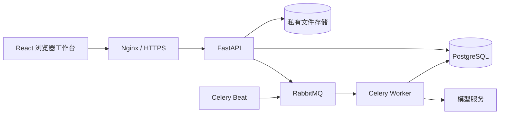

# 架构与运行边界

PaperLens 面向需要跨语言比较少量论文的学生与研究者。主流程是登录 → 保存文献 → 提交研究问题 → 后台分析 → 阅读带原文证据的报告。已有绿色视觉身份保留，工作台侧栏区分文献与分析；窄屏使用折叠导航，报告来源用支持键盘关闭的对话框展示。界面 tokens 位于 `frontend/src/styles.css`。

## 服务

Nginx 托管 Vite 构建的静态资源，同域代理 `/api`。SSE 提供任务状态更新，前端另以低频查询补充恢复。API 只处理验证、持久化与查询，模型执行位于独立 Worker。队列不向公网开放。

## 数据与权限

- `users`：邮箱与 scrypt 密码哈希；公开注册默认关闭，命令行创建账号和重置密码。
- `login_sessions`：仅保存随机会话令牌的 SHA-256；浏览器使用 HttpOnly / SameSite Cookie，HTTPS 下启用 Secure。
- 所有状态修改请求核对 CSRF token，有 Origin 时与配置的站点地址比对。
- `documents`：归属账号的 PDF 元数据与提取正文；对象键由服务端 UUID 生成。访问和下载都检查归属。
- `analysis_jobs`：归属账号的任务、输入快照、阶段检查点、进度与报告。输入文献在任务内部编号为 D1～D3。
- `usage_days`：用户行锁串行校验每日额度与并发限制；同一 submission UUID 只创建一次任务。
- 登录尝试在数据库中按来源地址和邮箱限制为每 15 分钟 10 次。Nginx 覆盖转发 IP，API 只通过内部网络访问。

数据库和对象存储都包含研究正文，需要限制权限、加密和异机备份。文件删除与报告删除分别执行；历史报告含快照，页面会明确说明保留范围。账号密码重置会撤销旧会话。

## 分析与恢复

任务状态是 `queued → running → completed / draft / failed`。每个已完成阶段都序列化到 PostgreSQL，包含问题拆解、单篇结果与报告。显式重试复用相同输入、模型和凭据配置下的阶段结果；草稿仅重新执行综合比较。模型配置变化会改变分析指纹，从头执行新配置对应阶段。

API 先提交任务再投递队列。投递失败时任务仍为 queued，由 Beat 每 15 秒扫描并补投。RabbitMQ 使用持久队列与发布确认，Worker 在任务结束后确认消费。数据库连接级 advisory lock 防止重复消息同时执行同一任务，进程退出自动释放。Worker 配置独占控制与事件队列，以适配 RabbitMQ 新版本。

这不是收费模型接口的“恰好一次”保证：如果模型已完成请求，而 Worker 在保存结果前被终止，恢复时该请求可能再次收费。已保存阶段不会重复调用。正常发布等待 Worker 完成，减少这一窗口。单任务软超时 20 分钟，硬超时 21 分钟。

FastAPI、Worker 使用同一 Python 镜像；它们可以独立扩容。单机 Compose 不承诺整机故障高可用。第一版不引入 Kubernetes、向量库、OCR 或多 Agent 框架。

## 发布

Quality 运行 Python 核心 / PostgreSQL 集成测试、前端类型 / 组件 / 浏览器测试、API 契约校验与镜像构建。main 的 push 检查成功后触发发布；PR 不触发部署。发布以源提交 SHA 构建、以镜像摘要部署，避免 latest 漂移；发现更新的 main 时跳过过时部署。

服务器使用 flock 串行发布，部署前备份数据库，应用 Alembic 迁移，等待当前 Worker 任务完成并替换服务。发布后同时核对 API 和前端的 SHA。失败恢复上一应用镜像；数据库不自动降级，迁移必须保持前后版本兼容。更改或删除字段采用分阶段迁移。

Nginx 切换会产生短暂连接重建；SSE 和页面查询恢复，不承诺零停机。数据库卷与文件卷独立于发布目录，禁止把 `docker compose down -v` 用作更新命令。

## 验收

- 核心：中英文 PDF 与边界、引文冻结、任务覆盖、模型错误及草稿续试。
- API：真实 PostgreSQL、认证 / CSRF / Origin、归属隔离、额度 / 去重、补投、续试、删除与 SSE。
- 浏览器：真实 API / RabbitMQ / Worker，以合成模型跑完整任务；检查刷新恢复、原文、键盘、无效输入和 320 / 375 / 768 / 1440 布局。
- 部署：构建镜像、Nginx 配置与代理、迁移一致性、数据库备份恢复、发布脚本失败恢复。

没有服务器、域名和凭据时，只能完成本地实现与验证，不能把 CI 文件存在当作线上部署已成功。
